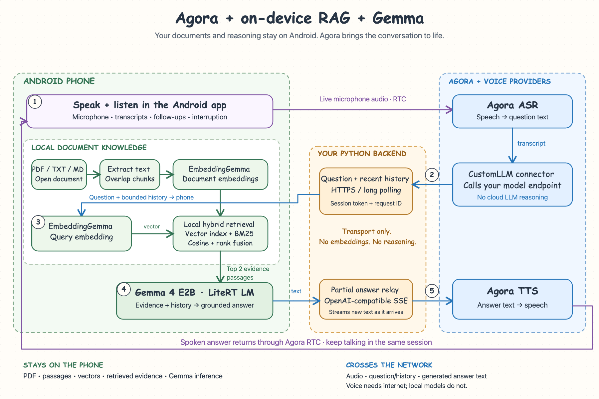

# Agora Conversational AI Android Quickstart

This repository is a template-style Android starter for building a Voice AI app with Agora Conversational AI.

It gives you a Kotlin + Jetpack Compose app backed by a small Python service that:

- joins an Agora RTC channel
- starts and manages an Agora Conversational AI agent through the backend
- listens for transcript, agent state, and pipeline metrics over RTM
- lets the user talk, mute, interrupt, and end the session
- supports typed instructions, direct speech, and queued requests
- supports response filler phrases in the original cloud-agent configuration; these are disabled in on-device document mode
- optionally looks up the project's setup and troubleshooting guidance
- keeps the App Certificate and token generation off the Android device


## Agora + on-device RAG + Gemma

The document demo runs **EmbeddingGemma, hybrid retrieval, and Gemma generation on the Android phone**. Agora supplies the ongoing voice session, speech-to-text, text-to-speech, transcripts, and interruption. There is no cloud answer-generating LLM in document mode.

### Current verification status

Local extraction, EmbeddingGemma retrieval, and Gemma generation have passed real-device tests. Progressive answer streaming passes automated relay tests. A complete live voice test of the latest streaming build is still pending; do not treat this as a latency-validated, event-ready release yet.

On the OnePlus DN2101, the latest successful CPU run measured 2.7 seconds for retrieval, 11.2 seconds from generation start to first text, and 12.5 seconds for complete generation. First audible speech also includes ASR, network, and TTS time. Streaming removes the wait for the *remaining* answer; it does not remove the initial model-processing delay.

GPU acceleration is experimental and is not the app default. The first GPU test failed because the app could not access OpenCL. Manifest changes are being tested; no successful GPU latency result has been established. CPU remains the verified path.

### First-time model setup

Model weights are not bundled in the APK or Git repository. Belal's repository also excludes them. Obtain the files from these sources and review the [Gemma terms](https://ai.google.dev/gemma/terms):

| Purpose | File | Source | Download size |
|---|---|---|---|
| Local answer generation | `gemma-4-E2B-it.litertlm` | [LiteRT Community Gemma 4 E2B](https://huggingface.co/litert-community/gemma-4-E2B-it-litert-lm/tree/main) | 2,588,147,712 bytes |
| Local document/query embeddings | `embedding_gemma.task` | [Google MediaPipe model bundle](https://storage.googleapis.com/mediapipe-models/text_embedder/embedding_gemma/int4int8/latest/embedding_gemma.task) | 183,816,181 bytes |

Use the standard Gemma `.litertlm` file, not GGUF, a desktop LM Studio model, or a device-specific accelerator variant. EmbeddingGemma requires the MediaPipe `.task` bundle; a raw TFLite file is not interchangeable.

In **Open document**, use **Import Gemma model** and **Import embedding model**. The app copies the files into its scoped model directory, validates their size and SHA-256 against the pinned downloads, and checks runtime compatibility when opening a document. Direct `adb push` setup bypasses the import hash check; use complete files from the linked sources. Importing from Downloads temporarily requires space for both source and destination copies. For a phone with limited storage, download on your Mac and push directly after installing the app:

```bash
adb shell mkdir -p /sdcard/Android/data/com.androidengineers.agent_quickstart_android/files/models
adb push /path/to/gemma-4-E2B-it.litertlm /sdcard/Android/data/com.androidengineers.agent_quickstart_android/files/models/gemma.litertlm
adb push /path/to/embedding_gemma.task /sdcard/Android/data/com.androidengineers.agent_quickstart_android/files/models/embedding_gemma.task
```

Restart the app after pushing model files. Models are stored across launches; documents and their vector index are currently in memory. Clearing app data or uninstalling removes model files. Real-device performance is not guaranteed: start with a short document, use an ARM64 Android phone (the demo APK packages only `arm64-v8a` to keep native libraries small), and allow time for model loading and indexing before the presentation.

### Run the voice demo

1. Run the Python backend and HTTPS tunnel using the setup below.
2. Set `PUBLIC_BASE_URL=https://your-tunnel-host` in `server/.env.local`, then restart the backend. Update this whenever the tunnel changes.
3. Configure the same HTTPS URL for Android with `./server/configure-android.sh https://your-tunnel-host`, then build and run.
4. Open the document panel, import both models if needed, and open a PDF/text/Markdown document.
5. Wait for local embedding/indexing and Gemma initialization to finish. Tap **Start voice session** and grant microphone access.
6. Keep talking naturally through Agora. Close the document panel for transcripts and call controls; reopen it for Gemma's latest answer, evidence, and retrieval/generation timings.

Keep the app open and connected. End the session before changing documents or models. Use [the fictional Field Kit manual](demo-documents/field-kit-manual.txt) for the first test: “How many minutes does a full charge take?” Then ask a follow-up or an unsupported question about warranty price.

### Engineering architecture



*Green: processing on Android. Blue: question/answer text through the relay. Purple: live Agora audio. The PDF, embeddings, and retrieved context stay on the phone.*

The relay is a transport adapter, not an LLM proxy to a cloud model. In document mode the agent is configured with `CustomLLM`, pointing to `/v1/document/chat/completions`. The backend retains its original cloud model configuration for API clients that do not request document mode; this event demo UI requires a prepared on-device document session.

### What runs where?

| Component | Implementation | Location |
|---|---|---|
| Extraction | PDFBox Android; selectable PDF text and UTF-8 files | Phone |
| Chunking | Up to 700 characters with approximately 100-character overlap, preferring whitespace boundaries | Phone |
| Embeddings | MediaPipe Text Embedder + EmbeddingGemma, using retrieval-document/query task formats | Phone |
| Search | Cosine ranking + BM25 (k1=1.2, b=0.75), combined with reciprocal rank fusion (k=60) | Phone |
| Context | Up to two complete passages, bounded question and recent conversation history | Phone |
| Answer generation | Gemma 4 E2B, LiteRT LM 0.14.0, CPU backend with four threads, 2048-token engine context | Phone |
| Session adapter | Request IDs, opaque session tokens, long polling, SSE framing, timeouts/cancellation | Python backend |
| Voice | Agora ASR, TTS, RTC, RTM and conversation turn handling | Agora/provider infrastructure |

Gemma receives evidence as untrusted reference text, is asked for a short spoken answer, and is instructed to refuse unsupported facts. These instructions do not guarantee grounding. Retrieval always ranks candidates; a semantic score is not a factual confidence score. UI passage IDs identify chunks, not PDF pages.

Previous user question and bounded conversation history help resolve follow-ups. The index is searched again for each turn. Native model work is serialized. The embedding runtime is closed after indexing and query embedding, before Gemma generation, to reduce peak memory pressure. Each generation uses a fresh conversation with explicit history to avoid cross-session model memory. Superseded/disconnected requests become inactive; the phone checks request status and cancels local generation. Gemma output is sent as cumulative snapshots, coalesced over 150 ms, while inference is running. The relay emits only the new text as SSE deltas so Agora can begin speech before the full answer completes. Final snapshots flush any remaining text; stale/non-prefix snapshots are rejected. The app displays local first-text timing separately from retrieval and total generation. This does not eliminate model prefill time, and first audible speech still depends on ASR, network, and TTS.

### Relationship to Belal's work and Voice Coach

This implementation uses the same runtime approach shown in [Belal Khan's on-device RAG course](https://github.com/probelalkhan/on-device-rag-android): LiteRT LM for Gemma (episode 2), MediaPipe EmbeddingGemma retrieval task formats (episode 3), and cosine/BM25 reciprocal rank fusion plus evidence context construction (episodes 5–6). The integration code here is original; the course's Hilt/Room/UI implementation is not copied wholesale. We currently keep vectors in memory rather than Room.

[Agora-Gemma-Voice-Coach](https://github.com/anandwana001/Agora-Gemma-Voice-Coach) demonstrates connecting Agora to local Gemma through a custom OpenAI-compatible model endpoint. That project uses laptop LM Studio/Ollama. This Android implementation uses the same adapter pattern but sends model work to the phone, where retrieval and generation execute.

### Data boundaries, limits, and validation

The original PDF, passage index, vectors, and retrieved context remain on the phone. Question transcripts, bounded conversation history, and generated answer text pass through Python and Agora. Voice still requires internet. Gemma and EmbeddingGemma themselves do not require network access after model setup. This is not a fully offline voice assistant.

PDF limits: 10 MB, 100 pages, 256 KB extracted text. Scanned PDFs need OCR, which is not implemented. Password-protected files are unsupported. UTF-8 text and Markdown are limited to 256 KB; the local index is capped at 256 overlapping passages. Start with short demo documents to keep indexing time manageable.

Generation has a 120-second timeout; the bridge waits up to 150 seconds. Long polling and SSE keep the relay connection alive, but tunnel/provider timeouts still matter. The backend must run as one worker; it keeps active requests in memory. Production needs application authentication, shared coordination, trusted model manifests, and a deliberate background-execution policy.

A real-model smoke test on the connected OnePlus DN2101 (Android 13, approximately 8 GB RAM) successfully loaded both models and generated: “A full charge for the Field Kit takes 90 minutes using the supplied charger [S1].” A second test with five indexed passages also passed: retrieval took 1.6 seconds and generation 11.6 seconds; total test time including indexing and initialization was 27 seconds. These are sample measurements, not a latency guarantee for larger PDFs or a completed Agora voice round trip.

Unit tests cover extraction, hybrid ranking, chunk overlap, bounded prompt construction, backend request/result isolation, SDK custom-model serialization, and Android contracts. `OnDeviceRagSmokeTest` is an opt-in physical-device test that loads real models, embeds the sample manual, retrieves its charging passage, and checks that Gemma answers with the document's 90-minute value. Build/tests alone do not establish real-device model performance or end-to-end voice success.


## Release 1.1.0 — Agora Conversational AI v2.12

This release integrates the Conversational AI Engine's v2.12 features with
`agora-agents==2.8.1` on the Python backend. Android uses RTC `4.6.4` and RTM
`2.3.0`. Engine, Python SDK, and Android SDK versions are independent.

See [the changelog](CHANGELOG.md) for the changes and [setup instructions](docs/setup.md#text-controls-and-project-guidance)
for the new text controls and optional custom tool. Each developer runs their
own backend and configures its HTTPS URL before building the Android app.

> [!NOTE]
> This quickstart requires the included Python backend. Local mobile testing uses a temporary public HTTPS tunnel so the Android device can reach the development server.

## Prerequisites

- Android Studio with JDK 17 or newer
- Python 3.10 or newer
- Bash for the scripts in `server/`
- An Android device or emulator with microphone support
- An Agora account with access to Conversational AI
- A development tunnel provider; the included helper supports Cloudflare Tunnel, ngrok, Tailscale Funnel, and LocalTunnel

The commands below assume a macOS or Linux shell. On Windows, run the backend scripts from WSL or an equivalent Bash environment.

## Quick Start

### 1. Install the Agora CLI and sign in

Skip this step if `agora` is already on your `PATH`.

```bash
curl -fsSL https://dl.agora.io/cli/install.sh | sh
agora --help
agora login
```

### 2. Get the quickstart

The recommended path lets the CLI clone the template and bind an Agora project. Replace `my-android-demo` with your app folder name:

```bash
agora init my-android-demo --template android
cd my-android-demo
```

`agora init` selects or creates an Agora project and records the project binding in `.agora/project.json`.

To work from an existing clone instead:

```bash
git clone https://github.com/AgoraIO-Conversational-AI/agent-quickstart-android.git
cd agent-quickstart-android
```

If you use an existing clone, you will select the Agora project when you configure the server in the next step.

### 3. Configure and run the Python server

```bash
python3 -m venv server/.venv
source server/.venv/bin/activate
pip install -r server/requirements-dev.txt
cp -n server/.env.example server/.env.local
agora project env write server/.env.local --template standard
./server/run.sh
```

The command above uses the project selected by `agora init`. For an existing clone, select the project explicitly instead:

```bash
agora project env write server/.env.local \
  --project <project-name-or-id> \
  --template standard
./server/run.sh
```

The server listens on `http://127.0.0.1:8000` and keeps `AGORA_APP_CERTIFICATE` off the Android device. Leave this terminal running. The local endpoint uses HTTP; the selected tunnel provider supplies the public HTTPS endpoint required by Android.

### 4. Create a temporary public HTTPS URL

In another terminal, run:

```bash
./server/tunnel.sh --provider ngrok
```

Choose `cloudflare`, `ngrok`, `tailscale`, or `localtunnel` with `--provider`. Keep the tunnel running and copy its generated `https://` URL.

Verify that the public endpoint reaches the Python server:

```bash
curl https://your-public-host/health
```

The response must be backend health JSON, not a tunnel-provider login or warning page. See [Local HTTPS tunnels](docs/local-tunnels.md) for explicit ngrok, Cloudflare Tunnel, Tailscale Funnel, and LocalTunnel commands.

### 5. Configure Android

Write the public server URL to root `local.properties`:

```bash
./server/configure-android.sh https://your-public-host
```

The script writes only this client value:

```properties
QUICKSTART_SERVER_URL=https://your-public-host
```

Do not put `AGORA_APP_CERTIFICATE` in `local.properties`.

### 6. Build the app

```bash
JAVA_HOME="/Applications/Android Studio.app/Contents/jbr/Contents/Home" ./gradlew :app:assembleDebug
```

If your shell already uses JDK 17 or newer, `./gradlew :app:assembleDebug` is sufficient.

### 7. Run it

Open the project in Android Studio, or run it from the command line, then launch it on a device or emulator.

Tap **Start voice session**, allow microphone permission, speak to the agent, and watch transcripts appear in real time.

If the agent does not join or transcripts do not appear, run:

```bash
agora project doctor --deep
```

If the temporary tunnel URL changes, run `server/configure-android.sh` again, rebuild, and reinstall the app. For manual setup, optional configuration, and production notes, see [docs/setup.md](docs/setup.md).

## What To Read First

If you are using this as a template, start here:

- [ConversationScreen.kt](app/src/main/java/com/androidengineers/agent_quickstart_android/ui/ConversationScreen.kt)
- [ConversationViewModel.kt](app/src/main/java/com/androidengineers/agent_quickstart_android/ui/ConversationViewModel.kt)
- [AgoraConversationSessionManager.kt](app/src/main/java/com/androidengineers/agent_quickstart_android/rtc/AgoraConversationSessionManager.kt)
- [ConversationAgoraApi.kt](app/src/main/java/com/androidengineers/agent_quickstart_android/data/ConversationAgoraApi.kt)
- [Python backend](server/app/main.py)

Those files show the full flow from UI action to Agora session setup.

## What To Customize First

Most teams will customize these pieces first:

1. `ConversationScreen.kt` for UI layout, branding, and session cards
2. `ConversationViewModel.kt` for app state, button actions, and session orchestration
3. `AgoraConversationSessionManager.kt` for RTC, RTM, and media behavior
4. `server/app/agora_client.py` for agent presets, geofence, and model configuration

## Build And Test

Run the Python server tests:

```bash
server/.venv/bin/python -m pytest server/tests
```

Compile Kotlin:

```bash
JAVA_HOME="/Applications/Android Studio.app/Contents/jbr/Contents/Home" ./gradlew :app:compileDebugKotlin
```

Run unit tests:

```bash
JAVA_HOME="/Applications/Android Studio.app/Contents/jbr/Contents/Home" ./gradlew :app:testDebugUnitTest
```

Assemble debug APK:

```bash
JAVA_HOME="/Applications/Android Studio.app/Contents/jbr/Contents/Home" ./gradlew :app:assembleDebug
```

## Docs

- [Setup](docs/setup.md): CLI, server, tunnel, and Android configuration
- [Local HTTPS tunnels](docs/local-tunnels.md): expose the development server to a physical device
- [Backend runbook](docs/backend-runbook.md): local server, public tunnel, API contract, deployment, and smoke checks
- [Architecture](docs/architecture.md): app structure, code map, session lifecycle, and state flow
- [Troubleshooting](docs/troubleshooting.md): common setup, agent, RTM, metrics, and microphone issues
- [Agent coding guidance](docs/agent-guidance.md): Agora CLI skills and guidance for AI coding agents

## Security Note

`AGORA_APP_CERTIFICATE` stays in `server/.env.local` and is never compiled into Android. The Python server generates the Android user's RTC/RTM token and uses the Agora Python SDK to start, interrupt, and stop the agent. A development tunnel URL is public while the tunnel is running, so stop the tunnel when testing is complete and add appropriate application authentication before adapting this demo for production.
